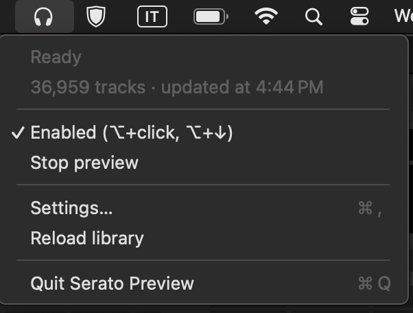
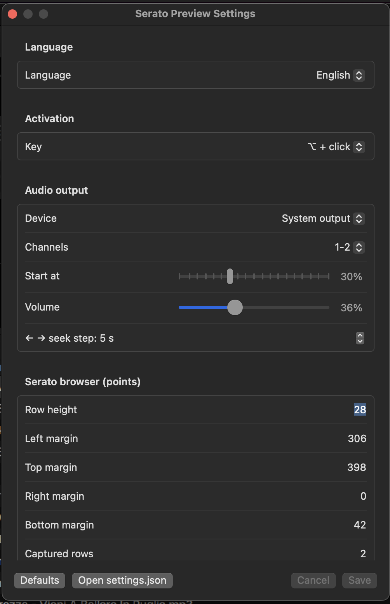

# Serato Preview

*[Leggi in italiano](README.it.md)*

A small macOS menu-bar app that lets you **preview a track from the Serato DJ Pro library in your headphones** without loading it onto a deck.

Hold ⌥ and click a row in Serato's browser (or press ⌥+↓ on the selected row): the app recognizes the track, finds the file in your Serato library and plays it on the output you choose, for example the headphone channels of your controller. The decks keep playing undisturbed.

## How it works

Serato's track list doesn't expose its contents to macOS (no Accessibility tree), so the app:

1. captures the clicked row from the screen (ScreenCaptureKit);
2. reads its text with on-device OCR (Vision);
3. matches the text against Serato's library, read **read-only** from `~/Library/Application Support/Serato/Library/master.sqlite`;
4. plays the file with AVAudioEngine on the chosen device and channels.

Nothing is sent over the network and Serato's library is never modified.

## Requirements

- macOS 14 Sonoma or later (Apple Silicon or Intel)
- Serato DJ Pro 5 (tested with 5.0.0)
- Swift 5.9 or later: the Xcode Command Line Tools are enough (`xcode-select --install`)
- Optional: a DJ controller with a multi-channel audio interface (tested with a Pioneer DDJ-FLX10, headphones on channels 3-4)

## Installation

### 1. Get the code

```sh
git clone https://github.com/deejay-tools/serato-preview.git
cd serato-preview
```

### 2. Create a signing certificate (once)

macOS ties the Accessibility and Screen Recording permissions to the app's signature. With a fixed certificate the permissions survive rebuilds; without it you have to grant them again after every build.

1. Open **Keychain Access** → menu **Keychain Access → Certificate Assistant → Create a Certificate…**
2. Name: `SeratoPreview Signing`, Identity Type: **Self Signed Root**, Certificate Type: **Code Signing**.
3. Click **Create**. Keychain Access will mark it as "not trusted": that's fine for signing.

To use a certificate with a different name: `SIGN_IDENTITY="My name" ./Scripts/build-app.sh`.

### 3. Build the app

```sh
./Scripts/build-app.sh
```

The result is `build/Serato Preview.app`. Move it to `/Applications` (or wherever you like) and open it: a headphones icon appears in the menu bar.

### 4. Grant the permissions

On first launch macOS asks for two permissions, both under **System Settings → Privacy & Security**:

- **Accessibility**: to intercept ⌥+click and the preview keys;
- **Screen & System Audio Recording**: to read the clicked row.

If something is missing, the app's menu shows it with a shortcut to the right settings page. After granting Screen Recording, quit and reopen the app.

## Usage

Open Serato DJ Pro, then:

| Action | What it does |
|---|---|
| **⌥ + click** on a row in the browser | Previews that track. Clicking the track that is playing stops it. |
| **⌥ + ↓** | Previews the row selected in Serato (the one highlighted in blue). |
| **↑** | Stops the preview. |
| **← / →** | Seeks back / forward (5 seconds by default). |

↑ ← → are taken by the app only while a preview is playing; otherwise they go to Serato as usual. ⌥+click outside the track list is passed to Serato untouched.

While a track is playing, a small floating player shows title, artist, BPM, key and progress. It never takes the keyboard focus, which stays with Serato. You can drag it anywhere and it remembers its position.

### DJ controller (MIDI)

The app listens to every MIDI controller without taking it away from Serato, which keeps receiving the same messages. Default mapping (Pioneer DDJ-FLX10, MIDI channel 2):

| Button | Note | Action |
|---|---|---|
| **SHIFT + LINK** | 67 | Previews the selected track / stops |
| **SHIFT + MIX POINT SELECT ◀** | 73 | Back |
| **SHIFT + MIX POINT SELECT ▶** | 66 | Forward |

SHIFT is used because without it those buttons have fixed functions in Serato (Link, pitch) that MIDI Learn can't remove.

For a different controller, find out what its buttons send with:

```sh
swift Tools/midi-monitor.swift --notes
```

then change the `midi` block in `settings.json` (see below). `kind` can be `note` or `controlChange`; channel is 1-16.

```json
"midi" : {
  "playStop" : { "kind" : "note", "channel" : 2, "number" : 67 },
  "back"     : { "kind" : "note", "channel" : 2, "number" : 73 },
  "forward"  : { "kind" : "note", "channel" : 2, "number" : 66 }
}
```

### Menu



From the headphones icon in the menu bar:

- the first two lines show the **status** (Ready, Playing…, Recognizing…) and how many tracks are loaded from the library; missing permissions appear here too, with a shortcut to the right settings page;
- **Enabled**: turns the app on or off without quitting it; when off, ⌥+click goes to Serato as usual and the MIDI buttons only control Serato;
- **Stop preview**;
- **Settings…** (⌘,);
- **Reload library**: the library is also reloaded automatically when Serato changes it (checked every minute).

## Settings



Open **Settings…** from the menu (⌘,). Changes are kept as a draft until you press **Save**; **Cancel** throws them away, **Defaults** fills the form with the default values (you still need to save).

### Language

**Language**: Italian, English or *System*, which uses Italian if it's the first language of macOS and English otherwise. The menu and the mini player change as soon as you save.

### Activation

**Key**: the modifier to hold while clicking a row, also used with ↓ to preview the selected row. Choose between ⌥, ⌃, ⌘⌥ and ⌃⌥.

### Audio output

- **Device**: where the preview plays. *System output* follows the macOS default; otherwise pick a specific interface. The number of channels is shown next to each name. To hear the preview only in your headphones, choose the controller.
- **Channels**: the stereo pair to use. On a 4-channel controller 1-2 is usually the master and **3-4 the headphones** (that's the case for the DDJ-FLX10). Check your controller's manual if in doubt.
- **Start at**: where the preview starts, as a percentage of the track (0-90%). 30% usually skips the intro and lands in the body of the song.
- **Volume**: preview volume, independent of Serato.
- **← → seek step**: how many seconds ← → (and the MIDI back/forward buttons) move, from 1 to 30.

Changing device or channels stops the preview that is playing.

### Serato browser (points)

These values tell the app where Serato's track list is inside its window. They are in points, measured from the window edges. You only need to change them if recognition fails or clicks in the list aren't caught (see [Calibrating the track list](#calibrating-the-track-list)).

- **Row height**: the height of a row in the list (28 with Serato's default font size).
- **Left / Top / Right / Bottom margin**: distance of the track list from the left, top, right and bottom edges of the window. ⌥+click outside this rectangle goes straight to Serato. *Top* is the most important one: it must point just below the column headers.
- **Captured rows**: how tall the captured strip around the click is, in rows. With 2 the clicked row is always captured whole, wherever you click inside it.
- **Truncated text gap**: Serato cuts long titles to fit the column. A text that ends closer than this (in points) to the next column or to the right edge is treated as cut off, and matched as a prefix.

### Recognition

- **Minimum score**: how sure the app must be (0.30-0.95) before playing a track. Lower it if correct tracks are reported as "not recognized"; raise it if the wrong track plays.
- **Fast OCR**: faster text recognition (a few tens of ms) instead of the accurate one (about a second per row on older Macs). Turn it off only if the text is read badly.

### The settings.json file

Everything is saved in `~/Library/Application Support/SeratoPreview/settings.json`. The **Open settings.json** button opens it in your text editor. Some options exist only there:

- `midi`: the controller buttons (see [DJ controller](#dj-controller-midi));
- `ocrLanguages`: languages for the OCR, in order of priority (default `["it-IT", "en-US"]`).

Missing keys take their default value. If the file can't be read, the app uses the defaults and shows the error at the bottom of the Settings window. After editing it by hand, quit and reopen the app.

### Calibrating the track list

The app needs to know where Serato's track list is inside the window. The defaults were measured on a 1440×863 Serato window (MacBook Pro M1). If your window has a different size or layout, or recognition fails:

1. Press ⌥+↓ on a selected row: the app saves the captured image in `~/Library/Logs/SeratoPreview/ultima-selezione.png`.
2. For more detail, from Terminal (the Terminal needs the same two permissions):
   ```sh
   swift run click-identify --calibrate
   ```
   Then ⌥+click anywhere in the Serato window: the tool prints every text it finds with its coordinates and saves the image. Ctrl-C to quit.
3. Set in Settings: **row height**, the **margins** of the list from the window edges (left, top, right, bottom, in points).

## Limitations

- Only tracks stored as local files: streaming tracks can't be previewed, nor tracks on a drive that isn't connected (the app tells you).
- Recognition is based on the visible text: if two different songs have the same title and artist in the visible columns, the app picks the best match. Copies of the same song in different folders are fine, since the audio is identical.
- If you resize the Serato window or change its layout, you need to recalibrate the list.

## Developer tools

| Command | What it does |
|---|---|
| `swift run library-dump` | Loads the Serato library and prints statistics and samples |
| `swift run library-dump --search "text"` | Finds tracks by title or artist |
| `swift run library-dump --match "Title\|Artist\|BPM\|Key"` | Shows how a row read by OCR is matched |
| `swift run click-identify [--save \| --calibrate]` | Logs the track recognized for each ⌥+click, without audio |
| `swift Tools/audio-test.swift list` | Lists audio devices and their channels |
| `swift Tools/midi-monitor.swift --notes` | Shows the MIDI messages from the controllers |
| `swift Tools/ax-dump.swift` | Dumps what Serato exposes through Accessibility |

Project layout:

- `Sources/SeratoLibrary`: reading the Serato library and text → track matching;
- `Sources/SeratoPreviewCore`: event interception, screen capture, OCR, audio, MIDI, settings;
- `Sources/SeratoPreview`: the menu-bar app (menu, mini player, settings);
- `Scripts/build-app.sh`: builds and signs the `.app`.

App logs are visible in Console.app by filtering on the subsystem `local.mac7.SeratoPreview`.

## License

[MIT](LICENSE).

## Disclaimer

Serato Preview is an independent personal project, not affiliated with or endorsed by Serato. "Serato" and "Serato DJ Pro" are trademarks of their respective owners.
